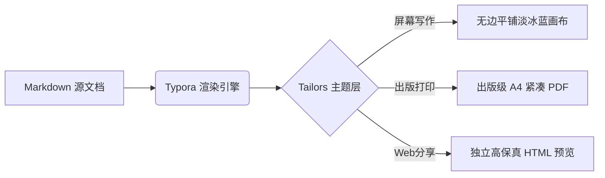

# Typora-Theme-Tailors 官方中文全景特性展示

<p align="center">
  <b>日落暮光天色渐变 × 新拟态 2.0 柔和立体光影 × 全幅温润淡冰蓝 × 出版级 A4 跨页排版</b>
</p>

<p align="center">
  <a href="https://chiamzhang.github.io/html/Typora-Theme-Tailors%20%20Introduction.html">🌐 在线效果预览 (Live Preview)</a> •
  <a href="https://github.com/ChiamZhang/TyporaTheme-Tailors">🏠 项目主页 (GitHub)</a> •
  <a href="README.md">🌐 English Documentation</a> •
  <a href="https://github.com/ChiamZhang/TyporaTheme-Tailors/archive/refs/heads/main.zip">⬇️ 下载主题包 (ZIP)</a> •
  <a href="https://github.com/ChiamZhang/TyporaTheme-Tailors/issues">💬 反馈与建议</a>
</p>

---

## 🔗 快速链接

- **🌐 在线实时效果预览**: [https://chiamzhang.github.io/html/Typora-Theme-Tailors%20%20Introduction.html](https://chiamzhang.github.io/html/Typora-Theme-Tailors%20%20Introduction.html)
- **⭐ GitHub 代码仓库**: [https://github.com/ChiamZhang/TyporaTheme-Tailors](https://github.com/ChiamZhang/TyporaTheme-Tailors)
- **⬇️ 主题包一键下载**: [TyporaTheme-Tailors.zip](https://github.com/ChiamZhang/TyporaTheme-Tailors/archive/refs/heads/main.zip)
- **📄 英文介绍文档**: [README.md](README.md)

---

## 📖 主题设计哲学

**Tailors** 是一款融合了 **Phycat（物理猫）** 日落暮光渐变神髓与 **Typora-Theme-Neumorphism** 新拟态立体光影的 Typora 顶级主题。

- **全幅温润淡冰蓝**：全窗口与导出画布统一采用 `#F9FCFF`，彻底消除刺眼纯白反光；
- **纯净无界平铺画布**：编辑页面与背景无缝融合，不设突兀卡片边框与沉重灰影，让写作沉浸自然；
- **新拟态 2.0 柔光立体微交互**：行内代码深邃凹槽、`<var>` 凸起浮雕胶囊、3D 触感复选框；
- **出版级 A4 导出**：正文默认小四号（12pt / 16px），从算法层彻底消除跨页大面积空白断层。

---

## 📑 目录结构展示

[TOC]

---

# 1. 标题视觉系统展示

Tailors 采用专门调校的 **Sunset Twilight（日落暮光）** 渐变与色阶系统，所有标题均配置了清晰的等宽几何标识与专属渐变质感：

## 1.1 二级标题胶囊

二级标题采用标志性日落渐变胶囊 `linear-gradient(135deg, #f7ce68, #fbabfe)` 搭配立体柔光阴影，是章节分割的核心视觉标杆。

### 1.1.1 珊瑚暮橙三级标题 (`◆`)

三级标题采用暖意珊瑚日落橙色 (`#ea580c`)，以优雅的菱形图标 `◆` 开启小节，并在标题末尾附带暖调几何渐变图案。

#### 1.1.1.1 暮光玫瑰四级标题 (`■`)

四级标题过渡至暮光玫瑰粉红 (`#f43f5e`)，搭配稳重方块图标 `■` 与 4 粒玫瑰光斑点阵。

##### 1.1.1.1.1 鸢尾罗兰五级标题 (`▲`)

五级标题采用尊贵鸢尾紫罗兰 (`#8b5cf6`)，搭配灵动三角图标 `▲` 与 5 粒暮光紫光斑。

###### 1.1.1.1.1.1 晴空湛蓝六级标题 (`—`)

六级标题收敛于极简晴空蓝 (`#0284c7`)，搭配精致等宽短横短杠 `—`，保持深层标题简洁而不失层级。

---

# 2. 内联文本与新拟态 2.0 元素

Tailors 对每一个 Markdown 内联元素都进行了专门的人机工学与美学微调：

- **加粗字体 (Bold)**：**深度加粗效果，采用深邃午夜蓝色相提高辨识度**
- *斜体强调 (Italic)*：*意大利经典倾斜字形，优雅而富有书卷气息*
- <u>下划线 (Underline)</u>：<u>采用 `#3b82f6` 晴空蓝悬浮下划线，彻底告别单调沉闷的纯黑线</u>
- ~~删除线 (Strikethrough)~~：~~已作废或修正的内容，带平滑半透明浅灰过渡~~
- ==荧光高亮 (Highlight)==：==温润琥珀暖阳渐变微光，长篇阅读绝不刺眼疲劳==
- 行内代码 (Inline Code)：`console.log("Tailors Neumorphism 2.0")`，独创深邃微凹槽微拟物立体设计
- 上标与下标 (Superscript & Subscript)：爱因斯坦质能方程 $E = mc^2$、水分子式 H~2~O、三维坐标系 $X^2 + Y^2 + Z^2 = R^2$
- 超链接 (Hyperlinks)：[Tailors GitHub 官方代码库](https://github.com/ChiamZhang/TyporaTheme-Tailors)，带悬浮动效平滑下划线
- 脚注注释 (Footnotes)：Tailors 主题内置了完整学术引用脚注系统[^tailors-footnote-cn]。

[^tailors-footnote-cn]: 这是 Tailors 主题的标准学术脚注实现，支持点击平滑回弹定位，并在悬停时呈现柔和立体胶囊气泡。

### 2.1 新拟态 `<var>` 凸起立体浮雕胶囊

在文本中直接使用 `<var>` 标签，即可调用新拟态 2.0 的浮雕药丸徽章：

- <var> 快捷参数：--output-format=pdf </var>
- <var> 核心算法：A4 Page-Break Pagination Optimization </var>
- <var> 核心色系：#F9FCFF Ice-Blue Canvas </var>
- 鼠标悬停在 <var> 悬浮试触此胶囊 </var> 上，会呈现微凹的物理按压触感！

---

# 3. 经典引文与装饰气泡

Tailors 的引用块采用新拟态浮雕卡片，并在右下角点缀标志性日落双气泡微拟物小球，悬停时会从暮光金晕染为深邃海蓝：

> 欲买桂花同载酒，终不似少年游！
> 
> *—— 经典单层引用展示。右下角伴有柔光新拟态立体小球，提供极具沉浸感的文学阅读体验。*

支持多层嵌套引用：

> 第一层引用：经典哲学思辨与工程实践的结合。
>
> > 第二层嵌套引用：Tailors 去除了多余的粗暴实心竖条，采用轻量橙色指示线，保证层级清晰且排版轻盈。

---

# 4. 任务列表与多级列表

### 4.1 3D 拟物触感任务复选框

Tailors 的任务列表摒弃了浏览器默认的生硬方框，采用 3D 新拟态微立体微动开关：

- [ ] **待办事项**：凸起立体白色微按键，带柔和漫反射环境阴影；
- [x] **已完成事项**：深邃凹陷内阴影微坑，镶嵌雪白勾选标记，伴随优雅删除线；
- [ ] 跨平台适配验证（macOS / Windows / Linux）；
- [x] A4 打印与 PDF 导出分页算法彻底优化。

### 4.2 多级有序与无序列表

1. 第一阶段：构思与色彩工学设计
   1. 提取日落渐变色相 (`#f7ce68` → `#fbabfe`)
   2. 确立淡冰蓝全幅底色 (`#F9FCFF`)
2. 第二阶段：排版与工程化重构
   - [x] 解决跨页大面积空白断层 Bug
   - [x] 重构 H1 ~ H6 等宽几何视觉符号
   - [ ] 丰富多语言代码高亮主题
3. 第三阶段：社区发布与推广

---

# 5. 暮光渐变数据表格

Tailors 表格表头采用日落渐变色相并自动处理圆角，行间采用柔和斑马纹，鼠标悬停时自动轻微浮起并伴随温暖琥珀金光指示条：

| 特性维度 | 原版主题局限 | Tailors 2.0 优化成果 | 状态 |
| :--- | :---: | :--- | :---: |
| **画布背景** | `#ffffff` 强光刺眼 | 全幅温润淡冰蓝 `#F9FCFF`，舒适护眼 | <var>已就绪</var> |
| **A4 跨页导出** | 第二页出现巨大空白 | 消除固定高度干扰，分页自然紧凑 | <var>出版级</var> |
| **页面边界** | 沉重灰色大卡片边框 | 纯净无边界平铺画布，沉浸式写作 | <var>纯净版</var> |
| **代码高亮** | 配色生硬无修饰 | macOS 红黄绿三色控制点 + 柔光画板 | <var>已实现</var> |
| **数字数据** | 默认字形不规范 | 等宽数字排版，财务与统计清晰对齐 | `$99,880.00` |

---

# 6. 代码块与语法高亮

所有代码块容器顶部均标配 **macOS 红黄绿三色精致微拟物按键**，代码区采用深灰磨砂立体柔光托底，提供长期编程阅读舒适度：

### 6.1 Python 数据科学示例

```python
import numpy as np
import matplotlib.pyplot as plt

def sunset_gradient(n_steps: int = 100) -> np.ndarray:
    """生成 Tailors 主题专属日落暮光色彩向量空间"""
    start_color = np.array([247, 206, 104]) / 255.0  # #f7ce68
    end_color = np.array([251, 171, 254]) / 255.0    # #fbabfe
    return np.linspace(start_color, end_color, n_steps)

if __name__ == "__main__":
    colors = sunset_gradient()
    print(f"Tailors gradient initialized with {len(colors)} chromatic steps.")
```

### 6.2 Modern C++ / Rust 核心算法

```cpp
#include <iostream>
#include <string_view>
#include <vector>

template <typename T>
concept PrintableTheme = requires(T t) {
    { t.render() } -> std::same_as<void>;
};

struct TailorsTheme {
    std::string_view name = "Tailors";
    double version = 2.0;

    void render() const {
        std::cout << "Rendering " << name << " v" << version 
                  << " with sunset twilight palette.\n";
    }
};

int main() {
    TailorsTheme theme;
    theme.render();
    return 0;
}
```

```rust
pub struct PageLayout {
    pub canvas_color: &'static str,
    pub font_size_pt: f32,
    pub is_seamless: bool,
}

impl Default for PageLayout {
    fn default() -> Self {
        Self {
            canvas_color: "#F9FCFF",
            font_size_pt: 12.0, // XiaoSi standard
            is_seamless: true,
        }
    }
}
```

---

# 7. 数学公式排版

Tailors 支持完整的 $\LaTeX$ 与 MathJax / KaTeX 公式排版，字符清晰饱满，与正文字阶完美融合：

### 7.1 行内公式 (Inline Math)

著名的质能方程是 $E = mc^2$，欧拉恒等式为 $e^{i\pi} + 1 = 0$，正态分布概率密度函数 $f(x) = \frac{1}{\sigma\sqrt{2\pi}} e^{-\frac{(x-\mu)^2}{2\sigma^2}}$。

### 7.2 块级公式 (Block Math)

$$\int_{-\infty}^{+\infty} e^{-x^2} \, dx = \sqrt{\pi}$$

$$\nabla \times \mathbf{E} = -\frac{\partial \mathbf{B}}{\partial t}, \quad \nabla \times \mathbf{B} = \mu_0 \mathbf{J} + \mu_0 \varepsilon_0 \frac{\partial \mathbf{E}}{\partial t}$$

$$\mathcal{L} = \mathbb{E}_{q(\mathbf{z}|\mathbf{x})}[\log p(\mathbf{x}|\mathbf{z})] - D_{\mathrm{KL}}(q(\mathbf{z}|\mathbf{x}) \parallel p(\mathbf{z}))$$

---

# 8. 图表与流程图

Tailors 为 Mermaid 图表提供了柔和的新拟态面板托底，线条清晰、字体自动继承：



---

# 9. 图片嵌入与智能缩放

Tailors 支持通过在图片 `alt` 或 `title` 中添加数字，快速实现百分比尺寸缩放：

1. **调整为 50% 宽度**：``
2. **调整为 30% 宽度**：``
3. **支持标准步进**：`0, 5, 10, 15, ..., 100`

<center>


</center>

---

# 10. 双主题方案与安装配置指南

Tailors 原生提供**双主题配置**，共享同一套高品质离线字体体系：
- ☀️ **Tailors (浅色/温润淡冰蓝版)**：`tailors.css`，适合日间高能写作；
- 🌙 **Tailors Dark (暗色/深邃暗夜版)**：`tailors-dark.css`，沉浸式夜间防眩光体验；
- 🖨️ **智能墨粉保护机制**：无论在浅色还是暗夜主题下，**导出 PDF 或物理打印均自动切换为纯白纸张模式**（杜绝黑纸浪费耗材），而导出 HTML / Web 分享则 100% 忠实还原暗夜视觉效果！

### 10.1 本地安装

1. 点击 **[下载最新主题包 (ZIP)](https://github.com/ChiamZhang/TyporaTheme-Tailors/archive/refs/heads/main.zip)** 并解压；
2. 打开 Typora，进入主题文件夹：
   - **macOS**: `偏好设置` → `外观` → `打开主题文件夹`
   - **Windows / Linux**: `文件` → `偏好设置` → `外观` → `打开主题文件夹`
3. 将解压出的：
   - `tailors.css`（浅色主题）
   - `tailors-dark.css`（暗色主题）
   - `tailors` 字体与资源文件夹
   复制粘贴进主题文件夹；
4. 重启 Typora，在菜单栏 **「主题 (Theme)」** 中可自由切换 **Tailors** 或 **Tailors Dark**！

### 10.2 本地导出 HTML / PDF

- **导出 HTML**：点击菜单栏 **「文件」➔「导出」➔「HTML (含代码高亮)」**，忠实保留当前所选主题（浅色或暗色）的完整光影质感；
- **导出 PDF / 打印**：点击菜单栏 **「文件」➔「导出」➔「PDF」**，系统自动触发 `@media print` 纯白纸张模式与 A4 紧凑分页！

---

## 💡 致谢与许可

- 灵感来源：
  - [Phycat](https://github.com/sumruler/typora-theme-phycat) by XuJilong（标题设计与日落天色神髓）
  - [Typora-Theme-Neumorphism](https://github.com/Soanguy/Typora-Theme-Neumorphism) by Soanguy（新拟态内联元素灵感）
- 字体支持：Bellota, Tw Cen MT, 霞鹜文楷, 华文中宋, HYHuaGuan
- 本主题遵循 [MIT License](LICENSE) 自由开源协议，欢迎 Star 与 Issue 反馈！
